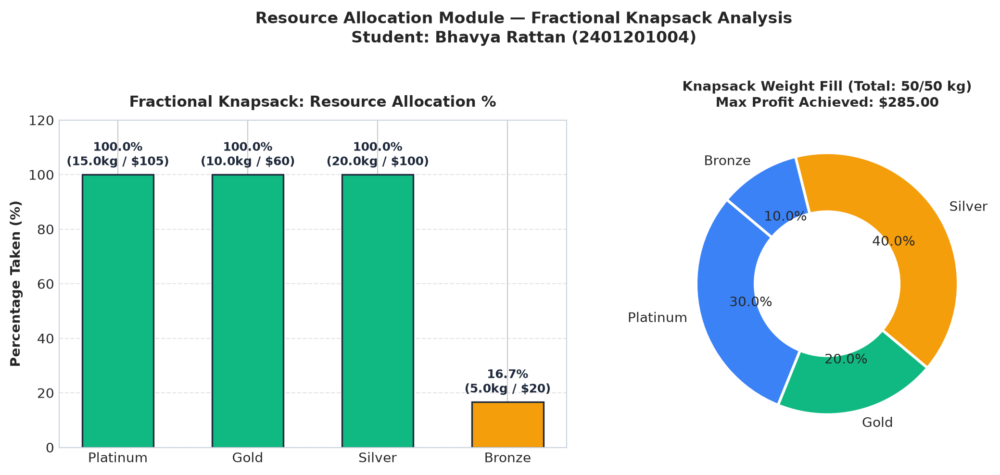
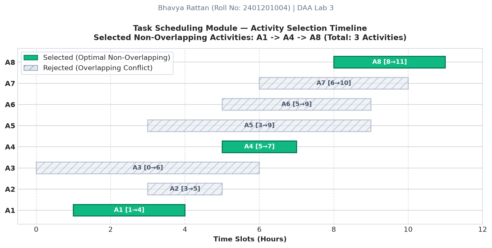
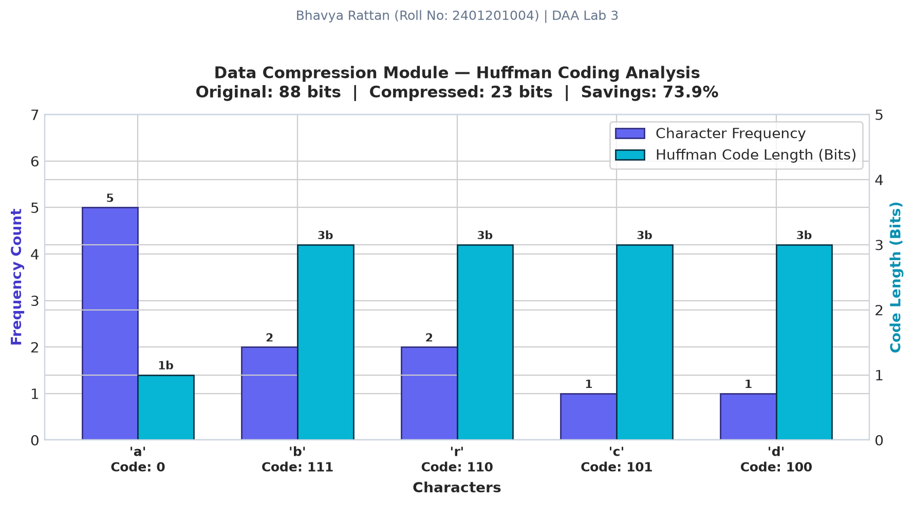
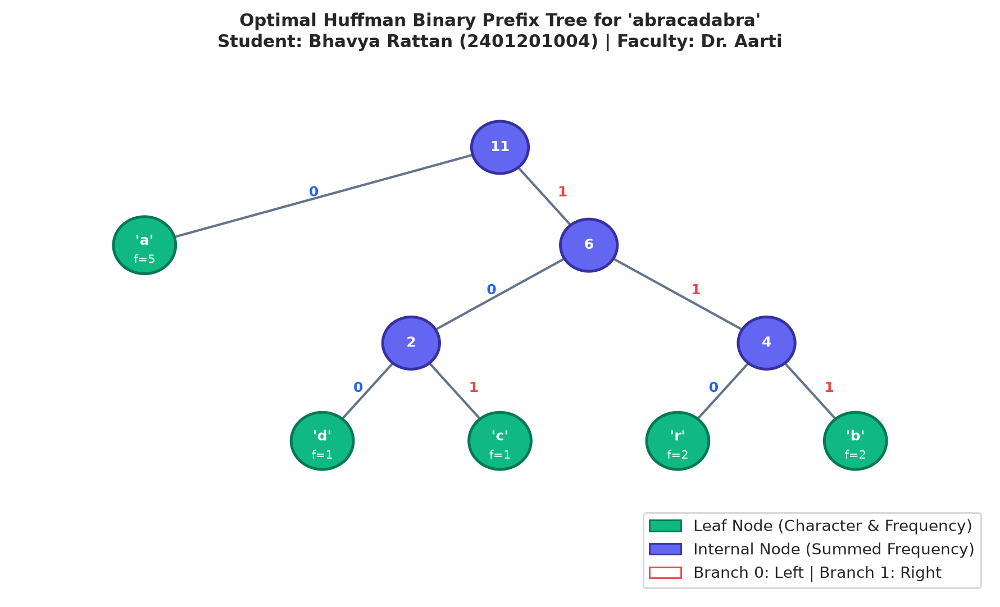
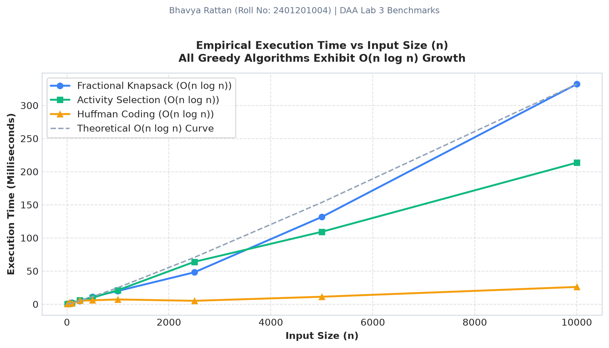
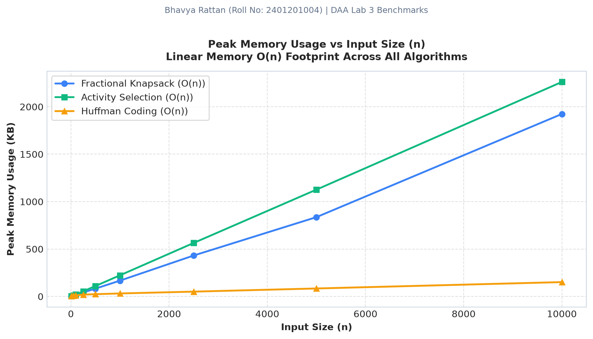

# Smart Resource Allocation and Scheduling System using Greedy Algorithms
### DAA Lab 3 — Design and Analysis of Algorithms (ENCA301)
**K.R. Mangalam University, Gurugram, Haryana**  
**School of Engineering and Technology (SOET) | BCA (AI & DS)**

[](https://www.python.org/)
[](LICENSE)
[]()
[-purple.svg)]()
[]()

---

## 📌 Project Overview
This repository contains the complete implementation, benchmarking suite, visualization engine, and analytical report for **Lab 3: Smart Resource Allocation and Scheduling System using Greedy Algorithms**.

The system addresses real-world optimization problems across three critical computational domains:
1. **Resource Allocation:** Maximizing utility from constrained physical/budgetary capacity using the **Fractional Knapsack** algorithm.
2. **Task Scheduling:** Generating conflict-free schedules that maximize concurrent throughput using the **Activity Selection** algorithm.
3. **Data Compression:** Minimizing communication bandwidth and storage footprint through variable-length prefix-free **Huffman Coding**.

---

## 📁 Repository Structure
```text
daa_lab3/
├── algorithms/
│   ├── __init__.py                # Package initialization and exports
│   ├── fractional_knapsack.py     # Module 1: Fractional Knapsack implementation
│   ├── activity_selection.py      # Module 2: Activity Selection implementation
│   └── huffman_coding.py          # Module 3: Huffman Coding & Decoding implementation
├── images/
│   ├── knapsack_allocation.png    # Resource allocation bar & donut charts
│   ├── activity_timeline.png      # Gantt-style activity scheduling timeline
│   ├── huffman_compression.png    # Character frequencies vs bit-lengths
│   ├── huffman_tree.png           # Visual hierarchical binary Huffman tree
│   ├── performance_comparison.png # Empirical runtime vs input size (O(n log n))
│   └── memory_usage_comparison.png# Peak memory usage vs input size (O(n))
├── app.py                         # Interactive menu-driven CLI application
├── benchmark_results.csv          # Empirical execution times & memory benchmarks
├── generate_benchmarks_and_charts.py # Automated benchmarking & visualization script
├── project_notebook.ipynb         # Full Jupyter Notebook covering Questions 1-7
├── Final_Report.md                # Comprehensive technical lab report (Question 7)
├── Lab3_Report_Bhavya_Rattan_2401201004.html # Styled printable HTML report
├── Visualizations_and_Charts_Bhavya_Rattan_2401201004.html # Charts presentation page
├── Benchmarking_Engine_Bhavya_Rattan_2401201004.html # Benchmarking interactive report
├── requirements.txt               # Project dependencies
├── .gitignore                     # Git ignore file
└── README.md                      # Project documentation
```

---

## 🚀 Quick Setup & Installation

### 1. Clone the Repository
```bash
git clone https://github.com/bhavyarattan/daa-lab3-greedy-system.git
cd daa-lab3-greedy-system
```

### 2. Create and Activate Virtual Environment
```bash
# On Windows (PowerShell / Command Prompt)
python -m venv venv
venv\Scripts\activate

# On Linux / macOS
python3 -m venv venv
source venv/bin/activate
```

### 3. Install Required Dependencies
```bash
pip install -r requirements.txt
```

---

## 💻 Running the System

### A. Run Interactive Menu-Driven Application
Launch the terminal user interface to test any module with preset datasets or custom user input:
```bash
python app.py
```

### B. Run Automated Benchmark Suite & Generate Visualizations
Re-run all timing and memory profiling across $n = 10$ to $n = 10,000$ and regenerate all charts:
```bash
python generate_benchmarks_and_charts.py
```

### C. Launch Jupyter Notebook
Open the interactive step-by-step notebook:
```bash
jupyter notebook project_notebook.ipynb
```

---

## 📊 Complexity Comparison Table (Question 5)

| Algorithm | Computational Problem | Greedy Selection Criterion | Time Complexity | Space Complexity |
| :--- | :--- | :--- | :---: | :---: |
| **Fractional Knapsack** | Resource Allocation | Highest Value-to-Weight Ratio ($\frac{v_i}{w_i}$) | $\mathbf{O(n \log n)}$ | $\mathbf{O(n)}$ |
| **Activity Selection** | Task Scheduling | Earliest Finish Time First ($f_i$) | $\mathbf{O(n \log n)}$ | $\mathbf{O(n)}$ |
| **Huffman Coding** | Data Compression | Lowest Frequency Subtree Merging | $\mathbf{O(n \log n)}$ | $\mathbf{O(n)}$ |

---

## 📈 Visualizations & Results Gallery (Question 6)

### 1. Fractional Knapsack: Resource Allocation


### 2. Activity Selection: Scheduled Timeline


### 3. Huffman Coding: Compression Statistics & Tree
| Huffman Frequency & Bits | Huffman Binary Tree Architecture |
| :---: | :---: |
|  |  |

### 4. Empirical Performance & Memory Scaling
| Execution Time Growth ($O(n \log n)$) | Peak Memory Footprint ($O(n)$) |
| :---: | :---: |
|  |  |

---

## 🎓 Academic Information
* **Student Name:** Bhavya Rattan
* **Roll Number:** 2401201004
* **Course:** Design and Analysis of Algorithms (ENCA301)
* **Semester:** 3rd Semester, BCA (AI & DS)
* **School:** School of Engineering and Technology (SOET)
* **Institution:** K.R. Mangalam University, Gurugram, Haryana
* **Faculty In-Charge:** Dr. Aarti
